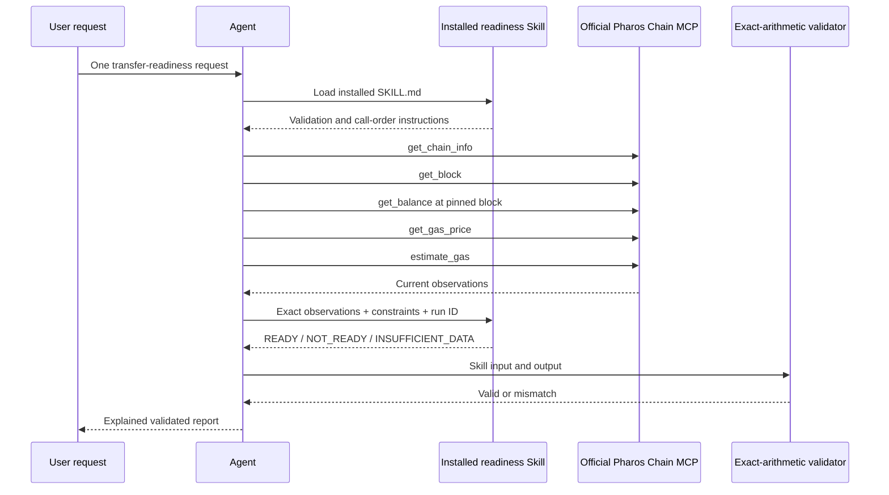

# Architecture

## Genuine composed agent runtime



This is genuine composition because the installed Skill consumes the exact outputs returned by Chain MCP in the same agent run. The tools are not independent demonstrations. `evidence/v1.0-live-affordable.json` preserves this dependency, tool order, normalized input digest, Skill output and validation.

## Hosted deterministic companion

The Cloudflare Worker cannot host the documented agent-loaded Skill runtime. Its `/api/evaluate` endpoint therefore evaluates editable constraints against the clearly labeled saved observation set. It does not claim a fresh Chain MCP call or Skill invocation. Genuine agent proof is served unchanged under `/evidence/`.

The companion uses Cloudflare D1 only for idempotent saved reviewer runs. No endpoint accepts a key, signs, broadcasts or spends PROS.

## Exact arithmetic

All token and gas quantities are decimal strings converted to `BigInt`. The decision is:

```text
bufferedGas = ceil(estimatedGas × (10000 + bufferBps) / 10000)
modeledGasCostWei = bufferedGas × gasPriceWei
totalRequiredWei = amountWei + modeledGasCostWei + reserveWei
READY iff balanceWei >= totalRequiredWei
      and gasPriceWei <= gasPriceCeilingWei
```

Unknown required observations fail closed as `INSUFFICIENT_DATA`.

## Limitations

- A gas estimate is not a guarantee.
- Chain MCP did not expose a way to pin the gas-price read to the balance block; the evidence discloses this.
- The public example address is an unattributed third-party address.
- The hosted companion is historical, not a fresh agent runtime.
- Native internal transfers, signing and broadcasting are outside scope.

